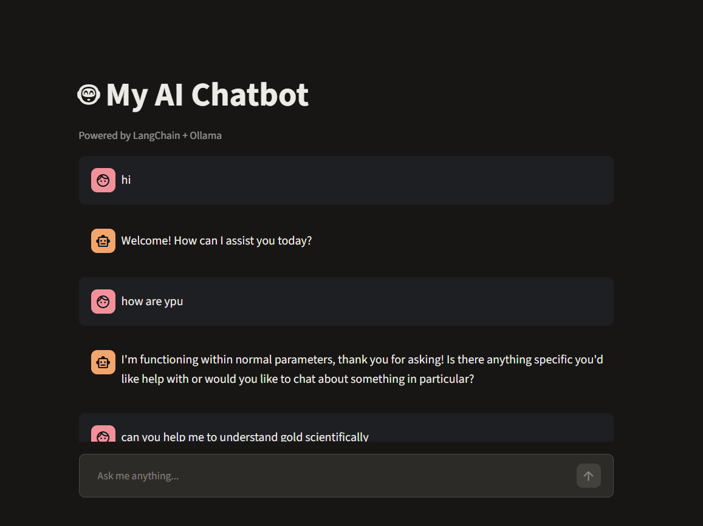

# Local AI Chatbot 🤖

🚀 **[Live Demo](https://local-ai-chatbot-tqvdnj57ewcwpjnmfr2jxl.streamlit.app/)** | 📂 **[GitHub Repository](YOUR_GITHUB_REPOSITORY_URL)**

A locally running AI chatbot built using Python, LangChain, Ollama, Llama 3.1 and Streamlit.

## 🌟 Features

- Interactive web-based chatbot
- Local LLM inference using Ollama
- Conversation history
- Context-aware conversations
- No paid LLM API required for local usage
- Simple and user-friendly web interface

## 🛠️ Tech Stack

- Python
- Streamlit
- LangChain
- Ollama
- Llama 3.1 8B

## 🏗️ Architecture

```text
User
  |
  v
Streamlit Web Interface
  |
  v
Python Application
  |
  v
LangChain
  |
  v
Ollama
  |
  v
Llama 3.1 8B
  |
  v
AI Response
```

## 📸 Screenshots



## ⚙️ Installation and Setup

### 1. Clone the repository

```bash
git clone https://github.com/YOUR_USERNAME/local-ai-chatbot.git
```

### 2. Navigate to the project directory

```bash
cd local-ai-chatbot
```

### 3. Create a virtual environment

```bash
python -m venv chatbot
```

### 4. Activate the virtual environment

Windows:

```powershell
chatbot\Scripts\activate
```

### 5. Install dependencies

```bash
pip install -r requirements.txt
```

### 6. Install Ollama

Download Ollama:

https://ollama.com/download

Download the Llama 3.1 model:

```bash
ollama pull llama3.1:8b
```

### 7. Run the application

```bash
streamlit run app.py
```

Open the application in your browser:

http://localhost:8501

## 📋 Requirements

- Python 3.10 or higher
- Ollama installed and running
- Llama 3.1 8B model downloaded
- Minimum 8 GB RAM recommended; 16 GB is preferable for this model

## 🎯 Learning Outcomes

- Understanding Large Language Models (LLMs)
- Integrating local LLMs using Ollama
- Building AI applications with LangChain
- Developing interactive interfaces using Streamlit
- Managing conversation history
- Deploying Python applications

## 👨‍💻 Author

**YOUR NAME**

GitHub: https://github.com/YOUR_USERNAME
